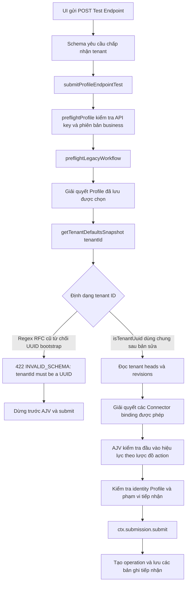

# Báo cáo: Workbench trả 422 khi đọc cấu hình mặc định của tenant

**Ngày:** 2026-10-15

**Phạm vi:** luồng `Test Endpoint` của Admin Workbench trong môi trường phát triển, với tenant mặc định của môi trường local.

## Kết luận

Lỗi xảy ra trước khi kiểm tra lược đồ của action và trước khi tạo operation (tác vụ xử lý). Workbench gửi tenant mặc định `00000000-0000-0000-0000-000000000001`. Schema của yêu cầu Workbench chấp nhận UUID này, nhưng `getTenantDefaultsSnapshot()` dùng bộ kiểm tra khác: nó chỉ chấp nhận UUID có version RFC `1–8` và variant `8`, `9`, `a` hoặc `b`. UUID bootstrap có đuôi `0001` không thỏa bộ kiểm tra đó, nên dịch vụ trả `422 INVALID_SCHEMA` với thông báo chính xác **`tenantId must be a UUID`**.

Bản sửa tại `orchestrator/services/orchestrator/src/modules/global-settings/service.ts:112-113` dùng lại `isTenantUuid` từ gói `@du/contracts`. Hàm chung yêu cầu UUID có đúng dạng `8-4-4-4-12` và chỉ gồm ký tự hex; nó không bỏ kiểm tra định dạng hay thay đổi quyền truy cập. Việc xác nhận tenant có tồn tại trong cơ sở dữ liệu vẫn diễn ra sau đó tại `service.ts:230-237`.

## Triệu chứng và bằng chứng

- UI ghi nhận lần thử Workbench với mã tương quan `d36e9ebd-b50d-48c0-95ed-f2fe5d4f8ec9` bị `422 INVALID_SCHEMA`.
- Một lần chẩn đoán an toàn riêng trên cùng đường xử lý trả thông báo `tenantId must be a UUID`; schema của yêu cầu chấp nhận tenant bootstrap trước khi gửi. Lần chẩn đoán không tạo operation và không lưu mã tương quan riêng. Nội dung đầy đủ của phần thân phản hồi lỗi từ lần UI không được lưu, vì vậy không khẳng định yêu cầu UI trùng khớp hoàn toàn với yêu cầu chẩn đoán.
- Sau bản sửa, lần thử qua UI trong môi trường phát triển với Connector mô phỏng hoàn tất sau 2,5 giây, ngay lần thử đầu. Operation `8e1afc19-dd17-408c-bb7c-cd861e38f89a` trả kết quả `{"category":"TEST","confidence":0.99}`.
- Kiểm thử hồi quy đơn vị chạy lại thành công: **1 bộ kiểm thử, 2 ca kiểm thử đạt**.

Workbench hiển thị tiêu đề lỗi, trạng thái HTTP, mã lỗi và mã tương quan, nhưng không hiển thị `detail` hay `errors[]`. Client cũng bỏ trường `detail` khi chuyển Problem Details thành kiểu lỗi của Admin Web (`orchestrator/apps/admin-web/src/lib/api/client.ts:1343-1359`). Vì vậy thông báo cụ thể ở trên đến từ lần chẩn đoán riêng, không phải nội dung đã hiển thị trong UI.

## Đường đi của yêu cầu

`AdminWorkbenchEndpointTestRequestSchema` khai báo `tenantId` là `z.string().uuid()` tại `orchestrator/packages/contracts/src/admin-workbench.ts:25-38`. Lần chẩn đoán xác nhận schema này chấp nhận tenant bootstrap. Sau đó luồng dịch vụ diễn ra như sau:



Vị trí trong mã nguồn thể hiện thứ tự trên:

- `orchestrator/services/orchestrator/src/modules/admin-workbench/service.ts:132-160` xác minh API key và phiên bản business đang hoạt động, gọi preflight để giải quyết Profile, sau đó kiểm tra tên, revision, trạng thái bật và selector endpoint của Profile.
- `service.ts:163-178` phân tích yêu cầu, chạy `preflightProfile`, rồi mới gọi `ctx.submission.submit` nếu preflight thành công.
- `orchestrator/services/orchestrator/src/modules/operations/submission.ts:594-638` giải quyết Profile hiệu lực, đọc cấu hình mặc định của tenant ở dòng 615, giải quyết Connector binding, rồi dùng AJV kiểm tra đầu vào hiệu lực ở các dòng 624-630.
- `submission.ts:866` cấp mã operation; câu lệnh `INSERT` operation nằm sau đó ở dòng 1049. Preflight bị lỗi nên không gọi tới `ctx.submission.submit`; cả hai bước này đều không chạy. Lần chẩn đoán trên dịch vụ cũng xác nhận không tạo operation.

Việc đọc cấu hình tenant trước AJV là hợp lý: cấu hình này có thể cung cấp Connector mặc định cho bước tiếp nhận, còn lược đồ action được kiểm tra trên đầu vào hiệu lực ở bước sau. Lỗi ở đây là hai bộ kiểm tra ID tenant không thống nhất, không phải thứ tự xác thực. Bản sửa thống nhất hàm kiểm tra identity tenant và giữ nguyên vị trí kiểm tra AJV.

Đây không phải lỗi lược đồ action: AJV chạy sau khi đọc cấu hình tenant. Đây cũng không phải lỗi ràng buộc Profile/API key: đường xử lý đã tới bước đọc cấu hình tenant sau khi giải quyết Profile được chọn. Với operator local, bước `assertAdminWorkbenchAdmissionScope` bổ sung nằm sau preflight và chưa được chạy trong yêu cầu thất bại; sự cố này không chứng minh rằng bước kiểm tra phạm vi quyền đó sẽ thành công.

## Sai khác trong kiểm tra và cách sửa

Trước khi sửa, dịch vụ đọc cấu hình tenant dùng biểu thức chính quy:

```text
^[0-9a-f]{8}-[0-9a-f]{4}-[1-8][0-9a-f]{3}-[89ab][0-9a-f]{3}-[0-9a-f]{12}$
```

Các nhóm `[1-8]` và `[89ab]` bắt buộc UUID phải có version và variant theo RFC. PostgreSQL lưu tenant bootstrap với dạng UUID hex `8-4-4-4-12` hợp lệ, dù các bit version và variant bằng 0. Quy tắc tương thích với PostgreSQL này được ghi trong helper contracts tại `orchestrator/packages/contracts/src/tenant-identity.ts:1-11`.

Trước bản sửa, hàm kiểm tra yêu cầu tenant tương đương:

```ts
function requireTenant(tenantId: string): void {
  if (!TENANT_ID.test(tenantId)) invalid('tenantId must be a UUID');
}
```

Hiện tại, hàm dùng predicate chung:

```ts
function requireTenant(tenantId: string): void {
  if (!isTenantUuid(tenantId)) invalid('tenantId must be a UUID');
}
```

Predicate `isTenantUuid` kiểm tra chuỗi dài 36 ký tự theo mẫu `8-4-4-4-12` gồm hex (`orchestrator/packages/contracts/src/tenant-identity.ts:8-11`). Cách sửa giữ nguyên việc từ chối giá trị sai định dạng và không bỏ qua `readHead()` hay kiểm tra tenant tồn tại. Khi chưa có head cấu hình, `service.ts:230-237` truy vấn bảng `tenants`; tenant có UUID hợp lệ nhưng không tồn tại vẫn nhận `404 NOT_FOUND`. Bản sửa cũng giữ nguyên kiểm tra lược đồ action bằng AJV và không chuyển bước này lên trước bước lấy cấu hình mặc định.

## Kiểm thử hồi quy

`orchestrator/services/orchestrator/tests/orv14-global-settings-tenant-snapshot.test.ts:19-37` kiểm tra cả hai phía của ranh giới:

1. Tenant bootstrap đã biết, chưa có revision cấu hình, vẫn nhận snapshot cấu hình mặc định.
2. ID tenant sai định dạng nhận `422 INVALID_SCHEMA` trước khi có truy vấn cơ sở dữ liệu.

Chạy kiểm thử tập trung từ thư mục `du-rework/orchestrator/services/orchestrator`:

```powershell
pnpm exec jest --runInBand tests/orv14-global-settings-tenant-snapshot.test.ts
```

Kết quả ngày 2026-10-15: **1 bộ kiểm thử đạt; 2 ca kiểm thử đạt**. Dữ liệu mô phỏng không kết nối cơ sở dữ liệu và không ghi dữ liệu.

## Phạm vi và bằng chứng còn thiếu

- Lần UI thành công sau bản sửa là quan sát trong **môi trường phát triển với Connector mô phỏng**. Không kiểm tra nguồn gốc image hay container Docker và không gọi nhà cung cấp thật. Kiểm thử đơn vị là kiểm tra hồi quy ở mức mã nguồn; không loại bằng chứng nào trong hai loại này tự chứng minh hành vi trên Docker hay môi trường vận hành thực tế.
- Connector ghi nhận mức sử dụng **2 token đầu vào / 1 token đầu ra** cho lần kiểm thử. Số liệu sử dụng tổng hợp của platform vẫn đang chờ; điều này không có nghĩa là sổ ghi nhận mức sử dụng của Connector hoàn toàn thiếu dữ liệu. Bản sửa kiểm tra tenant không thay đổi việc tổng hợp số liệu sử dụng.
- Lỗi tải tệp `409 STORAGE_UNAVAILABLE` xảy ra trước đó và các phản hồi `422 INVALID_SCHEMA` khác không có cùng thông báo server chính xác là những quan sát riêng. Báo cáo này chỉ quy nguyên nhân cho lỗi preflight cấu hình tenant đã xác định; không kết luận mọi lỗi Workbench hay tải tệp đều có cùng nguyên nhân.
- Bộ kiểm tra tenant trên tuyến HTTP Settings riêng tại `orchestrator/services/orchestrator/src/http/routes/internal-global-settings.ts:83` vẫn dùng biểu thức chính quy yêu cầu version/variant RFC. Phát hiện này được ghi nhận nhưng không sửa trong phạm vi hiện tại; tuyến đó có thể từ chối tenant bootstrap một cách độc lập.

## Tái hiện an toàn và phòng ngừa

Dùng lệnh Jest tập trung ở trên để kiểm tra ranh giới định dạng mà không cần thông tin xác thực, lời gọi HTTP, ghi cơ sở dữ liệu hay gọi nhà cung cấp. Muốn kiểm tra E2E trong môi trường phát triển, dùng Profile Workbench đã được cấp quyền và Connector mô phỏng hiện có; đối chiếu kết quả operation riêng với bằng chứng mức sử dụng của Connector.

Với các bộ kiểm tra ID tenant mới, dùng hàm kiểm tra chung `isTenantUuid` cho ID tenant được PostgreSQL lưu. Tách kiểm tra định dạng khỏi xác thực quyền và kiểm tra tồn tại: từ chối chuỗi sai định dạng trước, sau đó vẫn giữ truy vấn theo tenant và các kiểm tra quyền hiện hữu. Thêm kiểm thử hồi quy cho UUID bootstrap có đuôi `0001` cùng ca ID tenant sai định dạng để phát hiện sớm việc các lớp xác thực không thống nhất.
